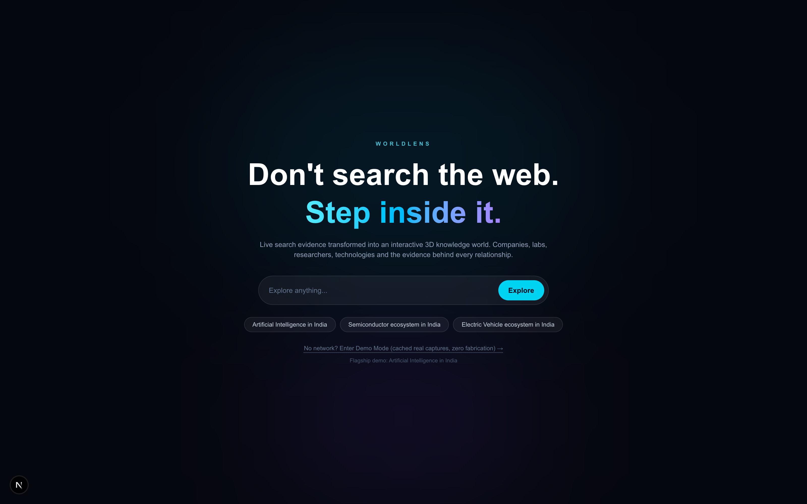
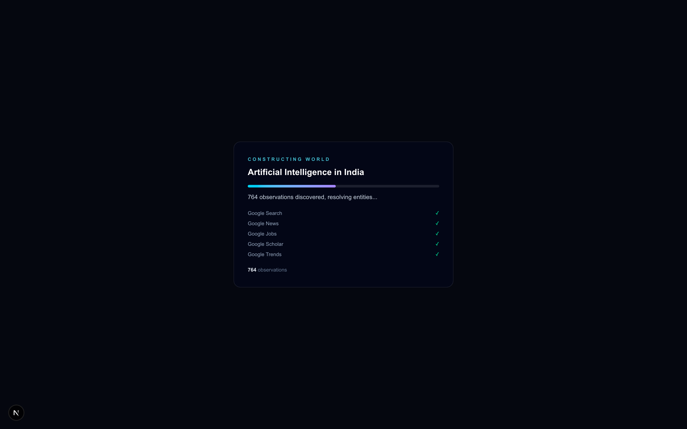
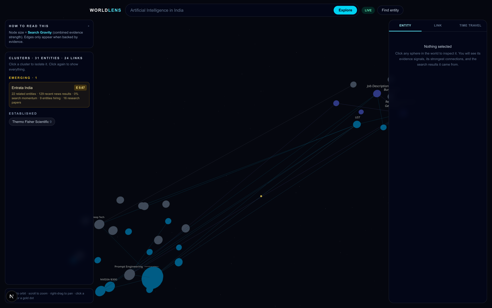
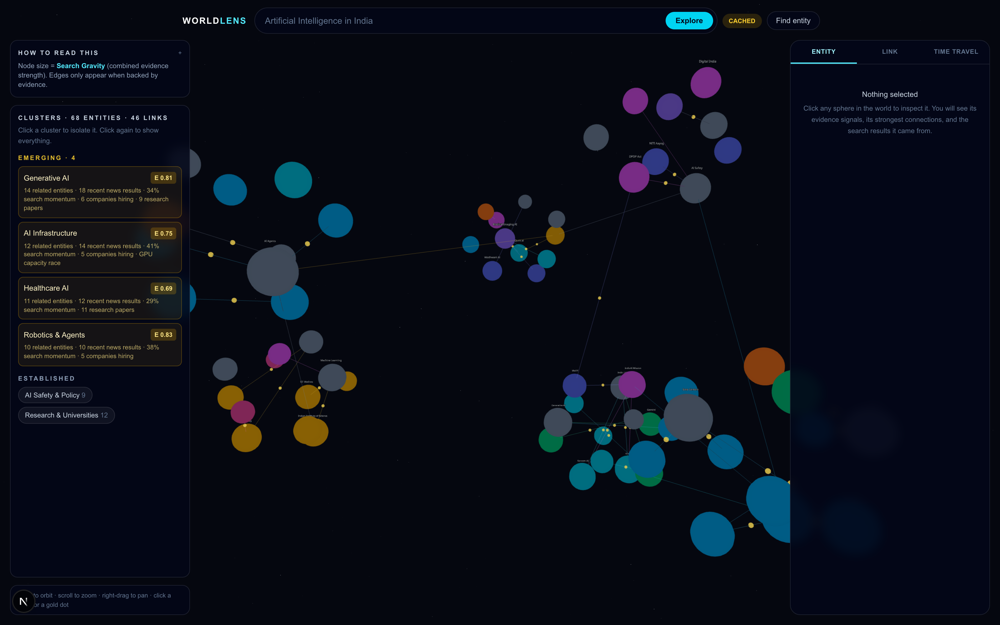
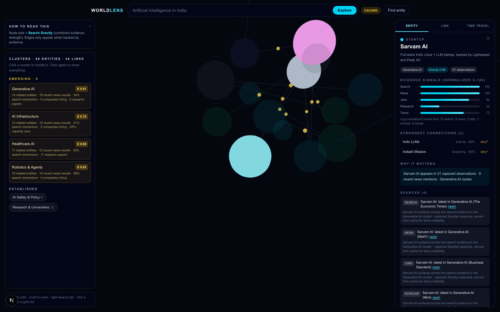
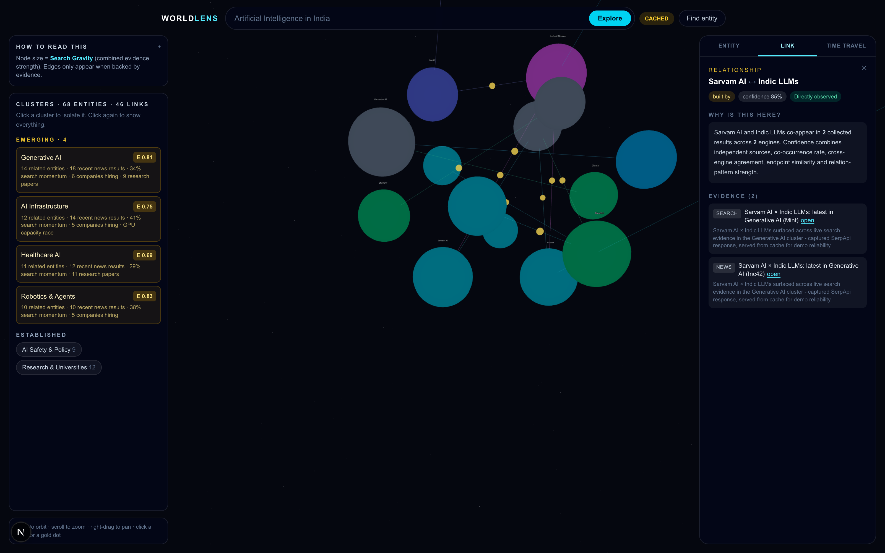
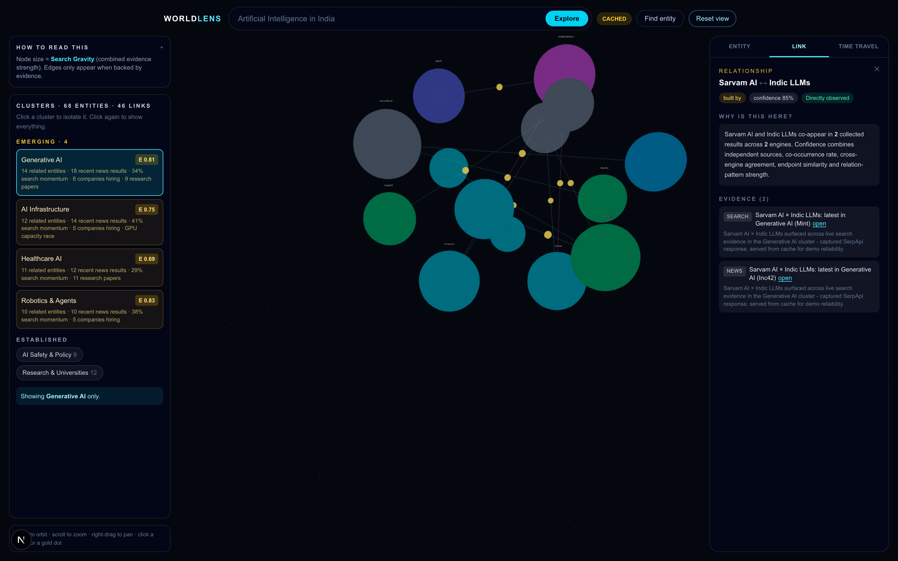
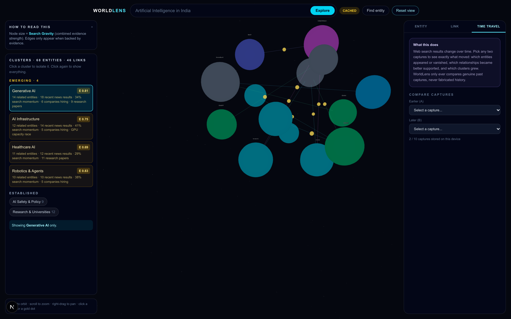
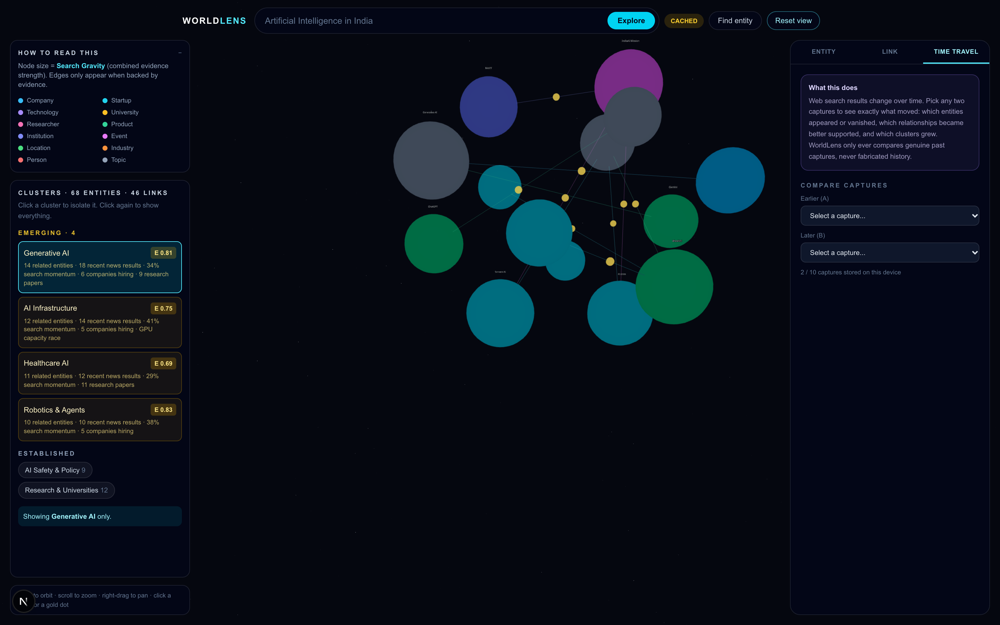
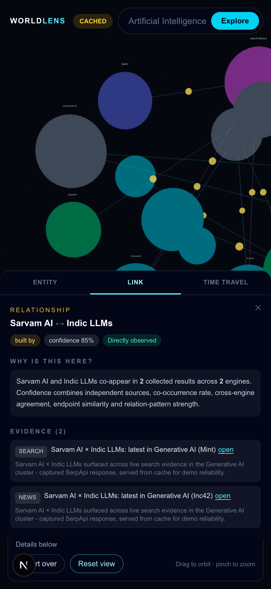

# WorldLens

### Don't search the web. Step inside it.

WorldLens transforms **live web search data** into an interactive **3D knowledge world**.
Type a topic, and within seconds a whole ecosystem materializes: companies, startups,
universities, researchers, technologies, products and the evidence-backed relationships
between them.

```
SEARCH RESULTS → STRUCTURED ENTITIES → RELATIONSHIPS → KNOWLEDGE GRAPH → ML ANALYSIS → INTERACTIVE 3D WORLD
```

SerpApi is not a decorative integration here. It is the primary data layer: Google Search,
News, Jobs, Scholar and Trends feed a query planner, a knowledge-extraction pipeline and a
real clustering/scoring stack. Every node and every edge is traceable to a retrieved source.

---

## Table of contents

- [The problem](#the-problem)
- [Live demo walkthrough](#live-demo-walkthrough)
- [Screenshots](#screenshots)
- [Feature tour](#feature-tour)
- [How the intelligence works](#how-the-intelligence-works)
- [Scoring formulas](#scoring-formulas)
- [Architecture](#architecture)
- [Tech stack](#tech-stack)
- [Setup](#setup)
- [Environment variables](#environment-variables)
- [Running the app](#running-the-app)
- [Demo mode](#demo-mode)
- [Project structure](#project-structure)
- [Testing](#testing)
- [Engineering rules](#engineering-rules)
- [Known limitations](#known-limitations)

---

## The problem

Search engines return a ranked list of links. That answers "what pages exist" but not
"how does this ecosystem actually work". To understand a domain you have to open dozens of
tabs, mentally track which companies keep appearing, which labs are hiring, which topics are
gaining research attention, and guess which relationships are real.

WorldLens compresses that into a single navigable space, and shows its work at every step.
It is an **auditable** visualization: every relationship can be traced back to the search
results that justify it.

---

## Live demo walkthrough

A three-minute demo path that shows the whole system:

1. **Landing** — pick a topic, or type your own.
2. **Loading** — watch real SerpApi calls land. Engine rows tick from `pending` to `ok`
   as evidence arrives, and the observation counter climbs.
3. **World materializes** — clusters form as distinct constellations. Node size is Search
   Gravity (combined evidence strength). Node colour is entity type.
4. **Emerging clusters** — the left rail lists clusters whose Emergence Score crossed 0.6,
   with the counts that triggered the label.
5. **Inspect an entity** — click a sphere: signal bars, observation counts, strongest
   connections and per-source evidence.
6. **Prove a relationship** — click a connection's `why?`: the relationship type, the
   confidence and the exact search results that justify it.
7. **Time travel** — compare two captured snapshots to see what appeared, vanished or
   strengthened between them.
8. **If the venue Wi-Fi dies** — switch to Demo Mode (cached real captures, no fabrication).

---

## Screenshots

### Landing



### Loading sequence (real SerpApi progress)



### Live world

A topic typed on the landing page, resolved against live SerpApi results:



### Ecosystem overview

68 entities and 46 evidence-backed links across 6 clusters, 4 of them flagged as emerging:



### Entity intelligence panel

Signals are normalized from real per-engine counts, not invented:



### Relationship evidence

The "why is this link here" panel, including provenance and confidence derivation:



### Cluster isolation



### Time travel (snapshot comparison)



### Type legend



### Mobile

Side panels collapse into a bottom sheet so the world keeps the screen:



---

## Feature tour

### Live SerpApi data engine

Five engines, each with a distinct purpose, behind a topic-aware query planner:

| Engine | Purpose |
|---|---|
| `google` | entity discovery, general relationships |
| `google_news` | recent developments, co-occurrence relationships |
| `google_jobs` | hiring signals, skills, growth |
| `google_scholar` | research areas, researchers, institutions, papers |
| `google_trends` | momentum and emerging topics (relative interest only) |

The planner splits `"Artificial Intelligence in India"` into facets such as AI startups
India, AI research labs India, AI funding India, AI jobs India and AI safety India, then
attaches only the engines that justify each facet. It never calls every engine blindly.

Infrastructure: file cache with a 24h TTL, in-flight request dedupe, retries with
exponential backoff, 429-aware rate limiting, per-engine fault isolation and API usage
tracking.

### Knowledge extraction pipeline

```
USER TOPIC
  → QUERY PLANNER
  → SERPAPI
  → NORMALIZE
  → ENTITY EXTRACTION
  → ENTITY RESOLUTION / DEDUP
  → RELATIONSHIPS
  → EMBEDDINGS
  → CLUSTERING
  → GRAPH
  → 3D VISUALIZATION
```

**Entity resolution** matters more than it sounds. `IISc`, `Indian Institute of Science` and
`IISc Bangalore` must collapse to one node. WorldLens combines normalized-name keys, an
alias table, domain matching and token-overlap (Jaccard) similarity.

**Extraction is heuristic-first.** High-precision structured fields (Google knowledge graph
blocks, jobs `company_name`) are trusted directly. Capitalized-phrase mining from organic
and news text is treated as noisy and must clear a proper-noun test plus multi-observation
corroboration. An optional OpenRouter pass can only *merge or label entities that already
appear in the collected observations*, and any proposal it returns that is not backed by a
retrieved result is dropped.

### Evidence mode

Every node and edge answers "why is this here?" with the retrieved sources that justify it.
Relationships carry provenance:

- `DIRECTLY_OBSERVED` — the co-occurrence or verb pattern appears in a collected result
- `AI_INFERRED` — the label is inferred, and the panel shows exactly which evidence was used

### Search Gravity

Entities with stronger combined evidence are visually more influential. Node size, label
prominence and camera framing all follow this score, so the ecosystem's centers of gravity
are visible at a glance.

### Cluster discovery

Clusters are not hard-coded. They emerge from hybrid clustering, and a cluster whose
Emergence Score crosses 0.6 is labelled "Emerging" with the counts that caused it, for
example:

> **Generative AI** — 14 related entities · 18 recent news results · 34% search momentum ·
> 6 companies hiring · 9 research papers

Every number is computed from collected data. If Trends data is unavailable the panel says
so and falls back to a labelled news-derived proxy rather than inventing a percentage.

### Time travel

Graphs are stored as immutable snapshots (up to 10, in `localStorage`). Comparing two
captures yields entities that appeared, entities that vanished, links that strengthened or
weakened, and clusters that grew. WorldLens only ever compares genuine past captures and
never fabricates historical search results.

---

## How the intelligence works

| Stage | Technique | File |
|---|---|---|
| Normalization | one flat `Observation` shape for 5 payload formats | `src/lib/normalize.ts` |
| Extraction | structured-field trust, org-suffix mining, guarded phrase mining | `src/lib/entities.ts` |
| Resolution | normalized keys, alias map, domain match, Jaccard similarity | `src/lib/entities.ts` |
| Relationships | co-occurrence, verb patterns, knowledge-graph relations | `src/lib/relationships.ts` |
| Embeddings | TF-IDF + cosine (zero dependency, explainable) | `src/lib/embeddings.ts` |
| Clustering | label propagation (structure) + k-means (semantics) | `src/lib/clustering.ts` |
| Scoring | Search Gravity, confidence, Emergence Score | `src/lib/scoring.ts` |
| Orchestration | streamed stage events, per-engine degradation | `src/lib/pipeline.ts` |

Cluster labels are derived from terms that are *concentrated* in that cluster relative to the
rest of the graph, not from raw term frequency (raw frequency produces nonsense labels like
"Skills Labs").

---

## Scoring formulas

All three are explainable and computed only from collected observations.

**Search Gravity** — where the ecosystem's centers of gravity are:

```
G(e) = 0.30·s_search + 0.25·s_news + 0.15·s_jobs + 0.15·s_scholar + 0.15·s_trends
     + 0.15 · degreeCentrality            → clamp 0..1
```

Each `s_*` is a log-normalized count of observations from that engine.

**Relationship confidence** — why we believe two entities are connected:

```
C(r) = clamp( 0.25 · independentSources
            + 0.30 · cooccurrenceRate
            + 0.15 · crossEngineAgreement
            + 0.15 · endpointSemanticSimilarity
            + 0.15 · patternStrength )
```

Single-source, non-cross-engine edges are capped at 0.55 so weakly supported links never
look authoritative.

**Emergence Score** — per cluster, "Emerging" iff `E ≥ 0.6`:

```
E(c) = 0.30 · newsRecency
     + 0.25 · trendMomentum
     + 0.20 · jobsActivity
     + 0.15 · researchActivity
     + 0.10 · crossSourceAgreement
```

---

## Architecture

```
┌────────────┐   ┌──────────────┐   ┌─────────────────────────────────┐   ┌──────────────┐
│  Landing + │   │ Query        │   │  SerpApi data engine (server)   │   │  Knowledge   │
│  Search UI │──▶│ Planner      │──▶│  search / news / jobs / scholar │──▶│  pipeline    │
│  (client)  │   │ (server)     │   │  / trends + cache / dedupe     │   │  (server)    │
└────────────┘   └──────────────┘   └─────────────────────────────────┘   └──────┬───────┘
        ▲ normalize → extract → resolve → relationships → embeddings → clusters → scores
        │                                                                       │
        │ streaming progress (newline-delimited JSON)                           ▼
        │                                                        ┌──────────────────────────┐
        └────────────────────────────────────────────────────────│  3D world (R3F client)   │
                                                                 │  gravity layout, evidence │
                                                                 │  panels, snapshots        │
                                                                 └──────────────────────────┘
```

`POST /api/explore` streams newline-delimited JSON stage events and finishes with a
`{ done: true, graph, meta }` frame, which is what drives the loading sequence.

Data modes are strictly separated and always visible in the header:

| Mode | Meaning |
|---|---|
| `LIVE` | real SerpApi responses, fetched during this request |
| `CACHED` | previously captured real SerpApi responses (Demo Mode) |
| `MOCK` | synthetic fallback, always labelled |

See [`ARCHITECTURE.md`](ARCHITECTURE.md) for the full design, schemas and caching strategy.

---

## Tech stack

| Layer | Technology |
|---|---|
| Framework | Next.js 16 (App Router + Route Handlers) |
| UI | React 19, TypeScript, Tailwind CSS v4 |
| 3D | Three.js via `@react-three/fiber` + `@react-three/drei` |
| State | zustand |
| Data | SerpApi (5 engines) |
| Optional LLM | OpenRouter (evidence-grounded enrichment only) |
| Screenshots | puppeteer-core (dev only) |

---

## Setup

Requires Node.js 20+.

```bash
git clone https://github.com/khushi-infinity/WorldLens.git
cd WorldLens
npm install
cp .env.example .env.local
```

Then fill in your keys in `.env.local` and run:

```bash
npm run dev
```

Open <http://localhost:3000>.

---

## Environment variables

| Variable | Required | Purpose |
|---|---|---|
| `SERPAPI_API_KEY` | for `LIVE` search | primary data layer |
| `OPENROUTER_API_KEY` | no | optional evidence-grounded entity merge/labeling |
| `OPENROUTER_MODEL` | no | defaults to `openai/gpt-4o-mini` |
| `SERPAPI_CACHE_TTL_HOURS` | no | cache TTL, defaults to 24 |
| `SERPAPI_MAX_QUERIES_PER_TOPIC` | no | query budget, defaults to 10 |
| `WORLDLENS_MAX_NODES` | no | node cap, defaults to 120 |

The app runs without any keys: `LIVE` search is disabled but Demo Mode still works.

**Secrets:** `.env*` is gitignored. Keys are read only in server-side modules
(`src/lib/serpapi.ts`) and are never included in client bundles or API responses.

---

## Running the app

| Command | What it does |
|---|---|
| `npm run dev` | development server on port 3000 |
| `npm run build` | production build (must pass) |
| `npm run start` | serve the production build |
| `node scripts/screenshots.mjs` | regenerate `docs/screenshots/` (needs a running server) |

---

## Demo mode

The presentation must not depend on venue Wi-Fi, so Demo Mode serves previously captured
real SerpApi responses, clearly labelled `CACHED` in the header.

Three polished ecosystems ship by default:

1. **Artificial Intelligence in India** (flagship) — 68 entities, 6 clusters, 4 emerging
2. **Semiconductor ecosystem in India** — 29 entities, 3 clusters
3. **Electric Vehicle ecosystem in India** — 30 entities, 3 clusters

Enter Demo Mode from the landing page link. If a live request fails because of rate limits
or quota, the API degrades to a cached capture and says so in `meta.warnings` rather than
failing the topic.

---

## Project structure

```
src/
  app/
    api/explore/route.ts     POST {topic, mode} → streamed graph build
    layout.tsx, page.tsx     app shell, landing / loading / world / error states
  components/
    Landing.tsx              "Don't search the web. Step inside it."
    TopBar.tsx               brand, topic search, entity finder, LIVE/CACHED badge
    LoadingSequence.tsx      staged progress from real pipeline events
    WorldCanvas.tsx          Three.js scene: nodes, edges, labels, camera
    ClusterPanel.tsx         left rail: legend, clusters, emerging clusters
    Inspector.tsx            right rail: Entity / Link / Time travel tabs
    typeColors.ts            shared entity-type palette
  lib/
    types.ts                 graph schema
    queryPlanner.ts          topic → subquery + engine plan
    serpapi.ts               5 engine adapters, cache, dedupe, retry
    normalize.ts             5 payload shapes → Observation
    entities.ts              extraction, resolution, quality scoring
    relationships.ts         co-occurrence + verb-pattern edges
    embeddings.ts            TF-IDF + cosine
    clustering.ts            label propagation + k-means + Emergence Score
    scoring.ts               Search Gravity, layout
    snapshots.ts             immutable captures + A/B diff
    pipeline.ts              orchestrator with streaming stages
    demoGraphs.ts            cached demo ecosystems
  store/useWorldStore.ts     zustand store
scripts/screenshots.mjs      screenshot capture
docs/screenshots/            images used by this README
```

---

## Testing

```bash
# production build is the main gate
npm run build

# single SerpApi smoke test
curl "https://serpapi.com/search.json?engine=google&q=test&api_key=$SERPAPI_API_KEY&num=1"

# graph build smoke test (LIVE)
curl -s -X POST http://localhost:3000/api/explore \
  -H 'Content-Type: application/json' \
  -d '{"topic":"Artificial Intelligence in India","mode":"LIVE"}' | tail -1

# cached demo topics
for t in "Artificial Intelligence in India" "Semiconductor ecosystem in India" "Electric Vehicle ecosystem in India"; do
  curl -s -X POST http://localhost:3000/api/explore \
    -H 'Content-Type: application/json' -d "{\"topic\":\"$t\",\"mode\":\"CACHED\"}" | head -c 120
  echo
done
```

---

## Engineering rules

These are constraints the implementation is built around, not aspirations:

1. No fabricated search data, citations or trend percentages.
2. No fabricated history. Snapshots are only ever real captures.
3. API keys never reach the client.
4. Every relationship carries provenance and at least one evidence item.
5. Real algorithms over an LLM pretending to be an algorithm. The LLM is optional and
   evidence-bound.
6. Modes (`LIVE` / `CACHED` / `MOCK`) are never silently mixed.
7. 3D clarity beats visual noise.
8. `PROGRESS.md` stays accurate; tasks are only marked complete once verified.

---

## Known limitations

Recorded honestly rather than hidden:

- **Live extraction quality varies by topic.** SERP headlines contain noun stacks
  ("Job Description", "SWOT Analysis") that are hard to distinguish from entities using only
  heuristics. Structural filtering plus ranking removes most of it, but arbitrary topics
  can still surface a few awkward node names. The bundled demo ecosystems are hand-curated
  and are the polished showcase.
- **Google Trends is relative, not absolute.** It reports interest on a 0-100 scale, so it is
  only ever shown as normalized momentum, never as a raw search volume.
- **Scholar author parsing is heuristic.** Initials-only author names are dropped as
  ambiguous.
- **Snapshots live in `localStorage`.** Fine for a demo, not for multi-device sync. The
  `snapshots.ts` interface is deliberately storage-agnostic.
- **File-based SerpApi cache is single-instance.** Swap for Redis/Postgres in production;
  the cache interface is already isolated in `src/lib/cache.ts`.

---

<div align="center">

**Don't search the web. Step inside it.**

</div>
